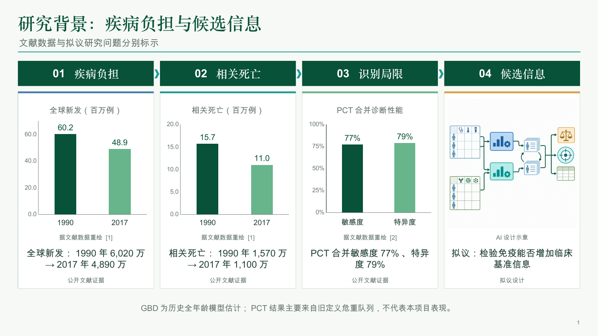
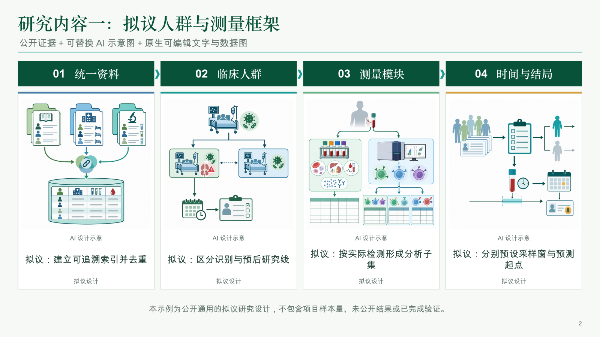

# Research Slide Workflow

**给出研究题目，生成以科研图为主、文字可编辑的研究背景、研究内容、后续计划与参考文献 PPT。**

面向生物医学科研汇报。把「找文献 → 核对主张和图数据 → 按项目设计科研图 → 制作可编辑 PPT → 渲染复查」整理为可重复运行的命令行流程。默认五页：背景 1 页、研究内容 2 页、后续计划 1 页、独立参考文献 1 页。四栏绿箭头是内置模板，可以修改排版代码或 JSON 内容。

题目足以生成**拟议研究设计草稿**；实际队列、已完成实验、发表成果和真实结果需要额外项目说明。背景结论只有在记录具体原文核查后才进入正式版。工具不会把生成图冒充论文图，也不会把检索到的 DOI 当作结论核实。





## 先试用：无需密钥

需要 Node.js 20+。示例使用已附科研设计 PNG 和公开文献数据，不调用付费 API。

```bash
git clone https://github.com/yetong0516/research-slide-workflow.git
cd research-slide-workflow
npm ci
npm run demo
```

打开 `build/demo/research-slides.pptx`。标题、说明、出处和原生数据图可以编辑；插图是独立可替换的图片对象。位图内部的线条/细胞不是独立 PowerPoint 形状。

## 从自己的题目开始

可先提供英文 PubMed 检索式，避免中文长题目零命中：

```bash
node cli.mjs init \
  --topic "常规检验与免疫指标在脓毒症识别及预后中的价值" \
  --query "sepsis AND (immune phenotype OR biomarker)" \
  --out runs/my-study/project.json
node cli.mjs run runs/my-study/project.json
```

默认 `rules` 规划和 `native` 模式无需模型密钥：检索真实文献，保留待核实背景与待配图框，再输出清楚标注的设计草稿。原生数据图需提供经过核查的数字，设计图需生成或手动加入。它是起点，具体方法需补充项目条件。`runs/` 默认不提交 Git。

希望按题目生成更具体的方案和 7–8 张科研示意图：

```bash
export OPENAI_API_KEY="填入你自己的API密钥"
node cli.mjs run runs/my-study/project.json --provider openai --mode openai
```

有密钥时，未给英文 query 的中文题目会先生成英文检索表达式。文本和图像接口可能产生费用，模型/地址/质量可在 `project.json` 的 `provider` 中修改；模型访问取决于自己的账户。未调用模型时不会假称 AI 已生成配图。

不要将患者信息、凭据或未获授权的未公开材料填进会发给外部模型的 `brief`。需要脱敏后的项目约束时，可用 `--brief examples/brief.template.json`；附件内容被当作资料，不是可执行指令。

## 分步控制与核查

```bash
node cli.mjs research runs/my-study/project.json
node cli.mjs plan runs/my-study/project.json --provider openai
# 核对 evidence.planned.json 的候选原句，添加具体的 claim review 与图数据来源
node cli.mjs plan runs/my-study/project.json \
  --evidence runs/my-study/output/evidence.planned.json --provider openai
node cli.mjs images runs/my-study/output/spec.json \
  --project runs/my-study/project.json --mode openai
node cli.mjs validate runs/my-study/output/spec.images.json --final
node cli.mjs build runs/my-study/output/spec.images.json --final
```

具体字段见 [文献核查](docs/evidence.md) 与 [完整工作流](docs/workflow.md)。关键 distinction：

| 内容 | 来源 | 展示要求 |
| --- | --- | --- |
| 背景事实/数字 | 已核查的真实文献 | 对应原句/图表位置、单位、比较与出处 |
| 论文原图 | 明确原始来源 | 保留坐标与图例，核对再利用许可 |
| 科研设计图 | AI 生成或原生示意 | 标「设计示意/拟议」，不承载实证数字 |
| 项目实际结果 | 项目提供且核实的材料 | 与已发表基础、未来计划分开 |

程序记录 `discovered → metadata verified → excerpt matched → reviewed claim` 的不同状态。原句命中不能证明翻译、外推或终点解释正确。人工核查完成后，在来源 `claims[]` 内记录已核查版本的 `text`、`status: "checked"`、`reviewed: true`、`reviewer`、`reviewNote` 与 `locator`。展示 caption 必须对应该核查版本。`--final` 检查核查记录完整性，不能替代科学判断。

未核查背景会有可见草稿提示。已核查主张还需要自己的原图或真实图数据；占位框不会被程序假装成文献配图。不要凭摘要还原论文没有给出的原始点、ROC 或生存曲线。

## 文件与可重复运行

每个项目输出独立文件：`evidence.json`、`evidence.planned.json`、`spec.json`、`spec.images.json`、`assets/`、`image-manifest.json` 和 PPT。`run` 默认续用已存的证据和排版，不覆盖人工核查及手改；需要重新规划请显式使用 `plan`。修改内容 JSON 后可以只重新 `build`；图片失败时已有图保留在进度文件，可用进度 spec 继续 `images`，避免重复生成。

- `src/evidence.mjs`：PubMed 检索与 Crossref / PubMed / Europe PMC 身份核对。
- `src/providers.mjs`：公共 HTTP 文本结构化输出和图像生成接口，可注入 mock。
- `src/workflow.mjs`：题目、约束、证据状态、科研图与 PPT 的编排。
- `src/schema.mjs`、`src/render.mjs`：数据契约与原生 PowerPoint 排版。
- `examples/demo/`：可离线运行的五页示例及图示出处说明。
- `prompts/`：科研设计图提示词骨架。
- `scripts/`：保存文件结构检查与可选渲染。

模型配置通过 `--config provider.json` 传给 `init`，例如：

```json
{
  "mode": "responses",
  "baseUrl": "https://api.openai.com/v1",
  "apiKeyEnv": "OPENAI_API_KEY",
  "textModel": "gpt-4.1-mini",
  "imageModel": "gpt-image-1",
  "imageSize": "1536x1024",
  "imageQuality": "medium"
}
```

也可用 `mode: "chat-completions"` 连接支持对应格式的兼容文本端点；图片端点仍需支持 GPT Image 的参数及 PNG base64 返回，并非任意服务商都兼容。请只把密钥发送到自己信任的 `baseUrl`。

接口实现依据 [OpenAI 结构化输出文档](https://developers.openai.com/api/docs/guides/structured-outputs) 和 [图像生成接口](https://developers.openai.com/api/reference/resources/images/methods/generate)。文献服务说明见 [NCBI E-utilities](https://www.ncbi.nlm.nih.gov/books/NBK25501/)、[Crossref REST API](https://www.crossref.org/documentation/retrieve-metadata/rest-api/) 与 [Europe PMC REST 服务](https://europepmc.org/RestfulWebService)。排版使用公开的 [PptxGenJS](https://github.com/gitbrent/PptxGenJS)，不依赖桌面应用私有运行时。

## 验证与预览

```bash
npm test
npm run demo
python3 scripts/inspect-pptx.py build/demo/research-slides.pptx --expected-slides 5
# 可选：先安装 LibreOffice 与 Poppler
python3 scripts/render.py build/demo/research-slides.pptx --out build/preview
```

逐页查看 PNG，检查中文字形、换行、图例、箭头、配图和文字是否匹配。字体在不同电脑可能替换，可在 `theme.fontFace` 选择本机中文字体。

第一版的付费文本/图像接口通过 mock 测试；离线 PPT 构建、结构检查与公开文献 API 已实际运行。生成新研究的完整付费 API 路径仍需读者用自己的账户验证，不能把 mock 通过说成真实模型请求成功。当前检索入口以 PubMed 生物医学文献为主；其他学科可增加检索适配器。

## 贡献与许可

欢迎补充其他学科的文献检索、版式、原生可编辑图型和更多经过核查的公开示例。修改后运行测试与示例；新增证据必须给原始出处及适用范围。

代码为 MIT。仓库附带的自有 AI 设计示意图可按仓库许可复用，并保留其「生成示意、非实验结果」身份；第三方文献、图片和数据仍遵守原有权利及引用要求，MIT 不覆盖第三方材料。仓库不包含实际患者资料、原始课题汇报或未公开结果。

English: An evidence-aware CLI for editable scientific slides. It separates bibliographic verification, claim review, real chart data, and proposed design imagery. Run `npm run demo` without an API key; optional OpenAI planning and illustration are configurable. Title-only inputs create proposed designs, not performed-study results.
