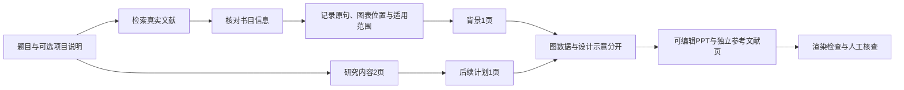

# 科研背景、内容与后续计划：同一条证据链

这套流程来自多轮科研汇报设计：先以项目资料定义研究问题，再核对文献原图和数据，最后减少文字、配置科研图并制作可编辑 PowerPoint。代码实现采用公共依赖，不需要 Codex 桌面运行时。

## 1. 把题目拆成可展示的问题

背景讲清「疾病/领域负担 → 现有问题 → 候选信息 → 研究目标」，每格只承担一个要点。开题模板的前三栏是可证实的文献背景，第四栏的拟议目标明确标识。研究内容讲清对象、比较、检测、终点与分析关系。后续计划讲清尚未完成的工作和交付物。七页开题框架与可选前期页见[模板说明](proposal.md)；五页精简汇报仍可继续使用。

只给题目时，研究内容与后续计划都是拟议设计；系统不能推断实际样本量、已测指标、检测时间、真实进度或已发表成果。已有项目请补充人群、对照、实际面板/方法、时间起点、终点、已完成工作与待确认事项。这些约束比「画得漂亮」更优先。

## 2. 建立主张与来源对应表

一条主张关联至少一条真实记录。需要区分四种状态：

| 状态 | 含义 | 能否作为已核实背景结论 |
| --- | --- | --- |
| discovered | 检索到论文 | 否 |
| metadata verified | DOI/PMID、题目、年份等对应 | 否，未核对结论 |
| excerpt matched | 所引原句确实出现在摘要/原文 | 否，仍需看是否支持主张 |
| claim reviewed / checked | 人群、终点、数字、单位、比较方向与适用范围均核对 | 可以，在其范围内 |

模型不能通过自报 checked 提升证据等级。研究设计示意不能代替实证。元数据核验只处理引用身份；即使 DOI 真实，错误的人群、终点或 AUC 解读仍会使结论失真。

每条背景主张建议记录：sourceId、DOI/PMID、原文摘录、section/table/figure/panel、单位、样本量、比较组、事件/时间范围、局限及核查说明。人工核查的 reviewer 是记录责任者，不是自动程序的签名。

## 3. 按信息类型选择科研图

| 信息 | 合适的图 | 不能做的事 |
| --- | --- | --- |
| 已发表数字 | 原生可编辑柱图/点图/表格，保存数据来源 | 让图像模型编造数字或原始点 |
| 已发表原图 | 原图独立嵌入，保留坐标、图例与署名 | 裁去影响解读的图例/轴，假装是本项目结果 |
| 项目实际流程 | 与项目一致的科研设计示意 | 添加没有测过的指标、没有开展的实验 |
| 尚待开展内容 | 标「拟议/设计示意」的流程或概念图 | 画出假 ROC、KM 曲线、P 值或预测获益 |

原图使用前核对版权/许可与再分发条件。下载不到或许可未知时保留链接、标记待补；不要把许可未知的图片打包发布。公开示例优先使用可溯源的原生数据图和自有生成示意。

## 4. 先做图，再缩短文字

四栏绿箭头是本仓库的一个可替换模板。图片保留原始比例，四栏表达流程；图下面原则上只有两行核心说明。细节进入备注，影响结论的条件留在可见页。

生成科研示意时写清：主体、箭头方向、每步输入/输出、比较关系、允许的符号、禁止的事实、白底与颜色、长宽比。图中不要生成中文说明；中文标题和标签用 PPT 原生文字叠加，便于修改。

例如模型增量比较，图应让两个模型来自相同患者、相同起点和相同基础变量；候选面板只加入第二个模型。不要画成两个人群或两种随意改变的算法。在训练内部完成预处理/选择；验证患者不回流训练步骤。

## 5. 保持图和字可编辑

原生标题、说明、出处、数据图/表可修改；PNG 插图是独立图片对象，可以移动、增删、替换，但位图内部的每个图形不是独立 PPT 形状。需要逐元素编辑时用 native chart/table，或另提供 SVG/设计源文件。不能把整页拍成图片交付。

## 6. 两类检查都要完成

机器检查：结构、所选模板的页面顺序、图/主张的来源关联、文字预算、图像类型与披露、原生数据来源及参考文献页。续跑还检查题目与模板，避免沿用另一课题的旧内容。

人工检查：打开最终 PPT 或渲染后的每页，核对中文字体、换行、图中箭头、生物学含义、坐标/单位、出处，以及「已发表 / 实际结果 / 拟议」是否混淆。通过自动测试不能证明医学结论正确，也不等于在 PowerPoint 中验收。

检查失败应保留明确的待核实状态，而不是补上虚构信息。完成核查再用于正式汇报或公开发布。
